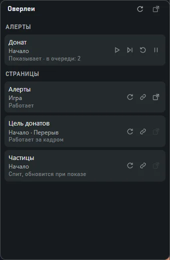
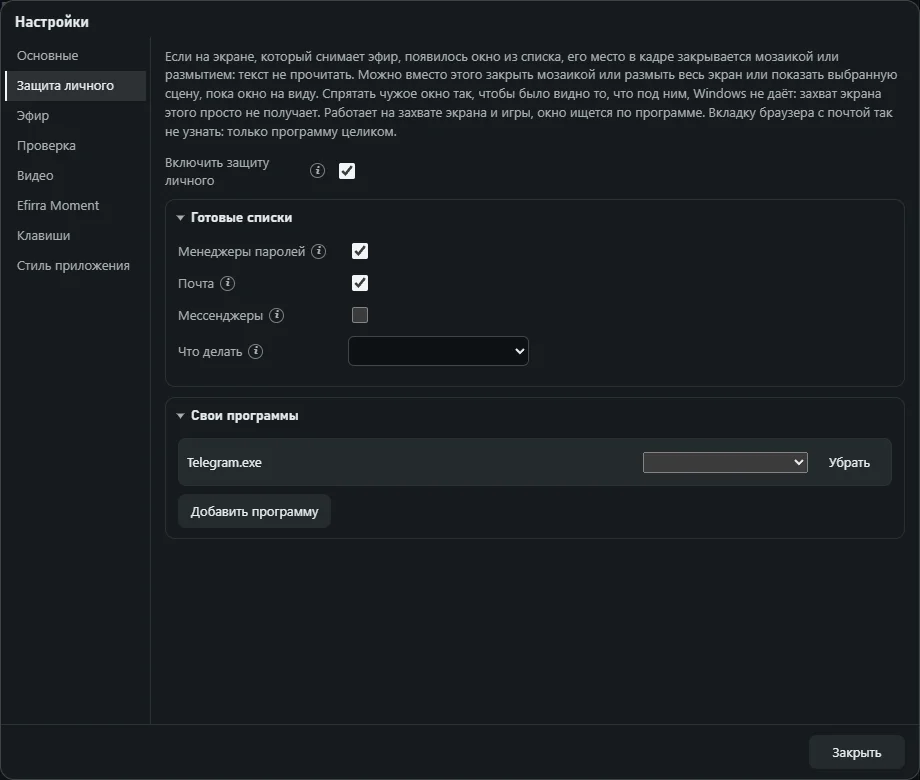
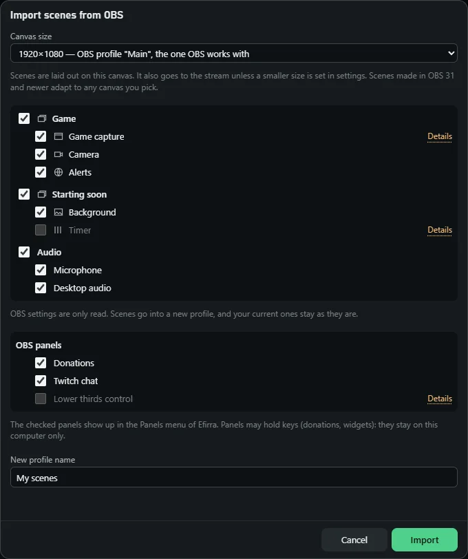

# Efirra

Программа для эфиров и записи на Windows: всё, что умеет OBS, плюс общий чат площадок, свои алерты и моды. [English below](#english)

**[Скачать установщик](https://github.com/Baamich/Efirra-releases/releases/latest/download/EfirraSetup.exe)** · [Все версии](https://github.com/Baamich/Efirra-releases/releases) · [Моды](https://github.com/Baamich/Efirra-mods)

## Зачем ещё одна программа для эфиров

- **Бережно к компьютеру.** Кадр от захвата до кодировщика не покидает видеокарту, страницы в неактивных сценах засыпают, а сама программа занимает 32 МБ против 461 МБ у OBS.
- **Всё нужное уже внутри.** Несколько площадок сразу, общий чат, алерты, защита личного в кадре, виртуальный микрофон с фильтрами — без плагинов и отдельных программ.
- **Переезд из OBS за пару минут.** Импорт сцен, источников, фильтров, переходов, браузерных панелей и настроек. Окно импорта заранее показывает, что не перенесётся и почему.
- **Пульты как у OBS.** Stream Deck, Streamer.bot, Touch Portal и свои программы подключаются по протоколу obs-websocket 5, как к OBS.

## Сравнение с OBS

Замер 18 ноября 2026, Efirra 0.6.4 и OBS 32.1.2 на одном ноутбуке (Intel i5-10500H, RTX 3050 Laptop, монитор 1080p 120 Гц). Обе программы с чистыми настройками, кадр 1920×1080 60 к/с, запись NVENC 6000 кбит/с, одна и та же сцена. Процессор — вся программа вместе с её браузером, в процентах от всех ядер, как в диспетчере задач.

| Сцена | Процессор, Efirra / OBS | Своя память, Efirra / OBS |
|---|---|---|
| Открыта, ничего не пишется | 0,4% / 0,5% | 293 / 203 МБ |
| Запись: экран и надпись | **0,6% / 1,0%** | 558 / 528 МБ |
| Обычный стрим: экран, надпись, 3 виджета | 1,3% / 1,1% | **771 / 820 МБ** |
| 8 виджетов с непрерывной анимацией | 8,5% / 8,5% | **926 / 1050 МБ** |
| Размер программы | **32 / 461 МБ** | |

- Видеокарта занята меньше: 27% против 38% на обычной сцене, 24% против 28% на сцене с анимацией.
- Виджеты в сценах, которых нет в эфире, у Efirra засыпают и почти ничего не тратят.
- Страницы рисуют ровно 60 кадров в секунду, как нужно эфиру, даже на мониторе 120 Гц и выше.
- Разница в десятые доли процента — в пределах разброса между замерами: одна и та же сборка от прогона к прогону даёт ±0,3%.
- Цифры одного компьютера. На видеокартах AMD и Intel они могут отличаться.

## Что умеет

**Эфир и запись**
- Twitch, YouTube, VK Видео Live, PartyWatcher и свой сервер — одновременно; каждую площадку можно запустить и остановить отдельно. Другие площадки, например Kick, подключаются как свой сервер: адрес и ключ.
- Вход через площадку вместо копирования ключа. Ключи хранятся в защищённом хранилище Windows. Все входы — на одной вкладке «Подключения».
- Панель **Об эфире**: название, категория и метки сразу на Twitch и VK Видео Live, без их сайтов.
- Свои кодировщики NVENC, AMF и Windows, без FFmpeg. Автобитрейт при плохой сети, задержка эфира, переподключение после обрыва и после сбоя видеокарты.
- Запись в MKV или MP4, HEVC, частями, отдельные дорожки каналов, метки. **Efirra Moment** — последние минуты экрана по одной клавише.
- Проверка перед эфиром: ключи, сеть, микрофон, звук и диск за полминуты.

**Сцены и источники**
- Один источник «Захват» для игры без внедрения в процесс, окна и монитора; камера, картинки и GIF, слайд-шоу, видео и списки видео, страницы, текст, чат в кадре.
- Группы, сцена в сцене, режим студии, мультивью (лишние сцены убираются правой кнопкой), переходы, в том числе роликом с прозрачностью.
- Виртуальная камера для Discord и Zoom: показывает эфир или свою сцену, например только веб-камеру на весь кадр.
- Эффекты: хромакей, маски, скругление и рамка, таблицы цвета, задержка картинки.

**Алерты и оверлеи**
- Свой алерт без браузера: картинки, ролики, звуки и подписи слоями, появление и уход, печать по буквам, градиент, контур и тень текста, варианты по сумме, сохранение в файл.
- Запуск клавишей, по таймеру, по событиям Twitch (подписка, подарок, рейд, биты), из Streamer.bot и скриптов.
- **Конструктор наград**: награды за баллы канала Twitch и VK и команды чата вроде `!огонь` запускают алерт, звук, сцену или скрипт.
- «Показывать мне»: алерт виден и стримеру поверх игры, а игра не теряет мышь и клавиши.
- Панель **Оверлеи**: все страницы и алерты всех сцен в одном месте — обновить застрявший виджет, не переключая сцену.

**Чат**
- Общий чат Twitch, YouTube, VK Видео Live и PartyWatcher в одной панели и в кадре, со смайлами. Можно разделить: сверху события (подписки, рейды, биты, награды), снизу зрители.
- Команды в чате без Streamer.bot: скрипт отвечает на `!тг` ссылкой прямо в чат VK или Twitch. Одно сообщение во все чаты сразу — из панели «Об эфире».
- Страницы-виджеты получают общий чат и громкость канала микшера: свой чат в кадре и полоски под музыку без отдельных программ.

**Звук**
- Микшер со своей громкостью на каждой сцене, шумодав, компрессор, эквалайзер, приглушение музыки голосом, плагины VST3.
- Отдельные миксы для эфира, наушников и виртуального микрофона. **Efirra Mic** держит голос с фильтрами в Discord, даже когда окно Efirra закрыто.
- Звуковая панель: звуки в эфир по кнопке и клавише.

**Защита и удобство**
- Защита личного: окно почты, мессенджера или менеджера паролей в кадре закрывается мозаикой или размытием.
- Горячие клавиши, работающие из игры, панели поверх игры и связки таких окон, профили, стиль оформления.
- Вкладка «Программы»: боты и мостики запускаются вместе с Efirra без окна консоли и закрываются вместе с ней.
- Настройки раскладываются в несколько колонок, окно настроек тянется за угол.
- Документация прямо в программе (F1) на русском и английском, с картинками.

**Автоматизация и моды**
- Скрипты на Lua в песочнице: без файлов, сети и ключа эфира, только с разрешения человека.
- [Каталог модов](https://github.com/Baamich/Efirra-mods): скрипты, языки, темы, алерты, эффекты, награды и панели от других людей. Свой мод можно отправить в каталог прямо из программы. Опасный мод владелец может отозвать, и программа удалит его сама.

## Установка

1. Скачайте и запустите `EfirraSetup.exe`. Права администратора не нужны.
2. Выберите папку и версию, по умолчанию стоит последняя.
3. Дальше обновления приходят сами: программа предлагает их при запуске и проверяет подпись каждого.

Установщик пока без подписи разработчика, поэтому Windows может показать предупреждение SmartScreen. Чтобы продолжить, нажмите «Подробнее» и «Выполнить в любом случае».

**Требования:** Windows 10 или 11, 64 бита. Видеокарта NVIDIA, AMD или Intel для кодирования (без неё — на процессоре). Microsoft Edge WebView2 установщик поставит сам, если его нет.

## Что сейчас происходит

Efirra развивается быстро: новая версия выходит раз в несколько дней, список изменений — в «Справка → Что нового» и в [выпусках](https://github.com/Baamich/Efirra-releases/releases). Сейчас в работе:

- название и категория эфира для YouTube и PartyWatcher (Twitch и VK уже есть);
- подпись установщика, чтобы Windows не предупреждала при установке;
- больше проверки на видеокартах AMD и Intel.

Это ранняя версия. Основная проверка идёт на Windows 10 с видеокартой NVIDIA. Если что-то не работает, приложите файл из «Справка → Открыть папку с логами» к [issue](https://github.com/Baamich/Efirra-releases/issues).

## Приватность

Телеметрии нет. Ключи эфира и входы на площадки хранятся только на вашем компьютере, в хранилище Windows, и идут напрямую на площадки. Логи никуда не отправляются сами.

## Лицензии

Efirra — закрытая программа, здесь только готовые сборки. FFmpeg в программе нет с версии 0.4.0; выпуски 0.3.1 и раньше раздавались с ним под LGPL, его исходники лежат в тех выпусках (`ffmpeg-source-*.zip`). Сторонние компоненты и их лицензии перечислены в `THIRD_PARTY.txt` рядом с программой, исходный файл под MPL-2.0 — в папке `mpl-sources` архива. Efirra не связан с OBS Project, Twitch, YouTube, Kick, VK, Discord, Elgato, VB-Audio и другими упомянутыми компаниями.

---

## English

A streaming and recording app for Windows: everything OBS does, plus a shared chat for all platforms, built-in alerts and mods.

**[Download the installer](https://github.com/Baamich/Efirra-releases/releases/latest/download/EfirraSetup.exe)** · [All versions](https://github.com/Baamich/Efirra-releases/releases) · [Mods](https://github.com/Baamich/Efirra-mods)

### Why another streaming app

- **Easy on your computer.** The frame stays on the GPU from capture to encoder, pages in inactive scenes go to sleep, and the app itself takes 32 MB against 461 MB for OBS.
- **Everything you need is built in.** Several platforms at once, a shared chat, alerts, privacy protection in the frame, a virtual microphone with filters — no plugins or extra apps.
- **Move from OBS in a couple of minutes.** Scenes, sources, filters, transitions, browser docks and settings are imported. The import window shows in advance what will not carry over and why.
- **Remotes like OBS.** Stream Deck, Streamer.bot, Touch Portal and your own programs connect over obs-websocket 5, just as to OBS.

### Compared with OBS

Measured on 18 November 2026, Efirra 0.6.4 and OBS 32.1.2 on the same laptop (Intel i5-10500H, RTX 3050 Laptop, 1080p 120 Hz monitor). Both apps with clean settings, a 1920×1080 60 fps frame, NVENC recording at 6000 kbps, the same scene. CPU is the whole app with its browser, as a share of all cores, like in Task Manager.

| Scene | CPU, Efirra / OBS | Private memory, Efirra / OBS |
|---|---|---|
| Open, nothing recorded | 0.4% / 0.5% | 293 / 203 MB |
| Recording: screen and a caption | **0.6% / 1.0%** | 558 / 528 MB |
| Typical stream: screen, caption, 3 widgets | 1.3% / 1.1% | **771 / 820 MB** |
| 8 widgets with constant animation | 8.5% / 8.5% | **926 / 1050 MB** |
| App size | **32 / 461 MB** | |

- The graphics card is less busy: 27% against 38% on a typical scene, 24% against 28% on the animated one.
- Widgets in scenes that are not on air go to sleep in Efirra and cost almost nothing.
- Pages draw exactly 60 frames per second, as the stream needs, even on a 120 Hz or faster monitor.
- Differences of a few tenths of a percent are within run-to-run spread: the same build varies by ±0.3%.
- These are numbers from one computer. AMD and Intel graphics cards may differ.

### Features

**Streaming and recording**
- Twitch, YouTube, VK Video Live, PartyWatcher and your own server at the same time; each platform starts and stops on its own. Other platforms, such as Kick, connect as your own server: an address and a key.
- Sign in with the platform instead of copying the key. Keys are kept in the protected Windows store. All sign-ins live on one Connections tab.
- The **Stream info** panel: title, category and tags on Twitch and VK Video Live at once, without their sites.
- Its own NVENC, AMF and Windows encoders, no FFmpeg. Automatic bitrate on a bad network, stream delay, reconnecting after a drop and after a GPU reset.
- Recording to MKV or MP4, HEVC, split files, separate channel tracks, markers. **Efirra Moment** saves the last minutes of the screen with one key.
- A pre-stream check: keys, network, microphone, sound and disk in half a minute.

**Scenes and sources**
- One Capture source for a game without injection, a window or a monitor; camera, images and GIFs, slideshows, videos and playlists, pages, text, chat in the frame.
- Groups, scene in a scene, studio mode, multiview (right-click removes scenes you do not need), transitions including a stinger with transparency.
- A virtual camera for Discord and Zoom: it shows the stream or a scene of its own, say just the webcam on the whole frame.
- Effects: chroma key, masks, rounded corners and borders, color tables, picture delay.

**Alerts and overlays**
- A built-in alert without a browser: pictures, clips, sounds and captions as layers, entrance and exit, typewriter text, gradient, outline and shadow, variants by amount, saving to a file.
- Triggered by a hotkey, a timer, Twitch events (sub, gift, raid, bits), Streamer.bot and scripts.
- **Reward builder**: Twitch and VK channel point rewards and chat commands like `!fire` start an alert, a sound, a scene or a script.
- "Show me": the alert is also shown to the streamer on top of the game, and the game keeps the mouse and keys.
- The **Overlays** panel: every page and alert of every scene in one place — refresh a stuck widget without switching scenes.

**Chat**
- A shared chat of Twitch, YouTube, VK Video Live and PartyWatcher in one panel and in the frame, with emotes. It can be split: events (subs, raids, bits, rewards) on top, viewers below.
- Chat commands without Streamer.bot: a script answers `!tg` with a link right in the VK or Twitch chat. One message to every chat at once from the Stream info panel.
- Widget pages get the shared chat and a mixer channel's volume: your own chat in the frame and music bars without extra programs.

**Sound**
- A mixer with its own volume on every scene, noise suppression, compressor, equalizer, music ducking under your voice, VST3 plugins.
- Separate mixes for the stream, headphones and the virtual microphone. **Efirra Mic** keeps your filtered voice in Discord even when the Efirra window is closed.
- A soundboard: sounds on stream by a button or a hotkey.

**Protection and comfort**
- Privacy protection: a mail, messenger or password manager window in the frame is covered with a mosaic or blur.
- Hotkeys that work from games, panels on top of the game and linked panel windows, profiles, app styles.
- The Programs tab: bots and bridges start with Efirra without a console window and close with it.
- Settings flow into several columns, and the settings window resizes from its corner.
- Documentation inside the app (F1) in English and Russian, with pictures.

**Automation and mods**
- Lua scripts in a sandbox: no files, network or stream key, and only with the person's permission.
- [Mod catalog](https://github.com/Baamich/Efirra-mods): scripts, languages, themes, alerts, effects, rewards and panels by other people. You can send your own mod to the catalog right from the app. The owner can revoke a dangerous mod, and the app removes it by itself.

### Install

1. Run `EfirraSetup.exe`. No administrator rights are needed.
2. Choose a folder and a version. The latest one is selected by default.
3. Updates are offered at launch, and each one has its signature checked.

The installer has no developer signature yet, so Windows may show a SmartScreen warning. To continue, choose "More info" and "Run anyway".

**Requirements:** 64-bit Windows 10 or 11. An NVIDIA, AMD or Intel graphics card for encoding (without one, the CPU encodes). The installer adds Microsoft Edge WebView2 if it is missing.

### What is happening now

Efirra moves fast: a new version comes out every few days, and the changes are in Help → What's new and in the [releases](https://github.com/Baamich/Efirra-releases/releases). In progress now:

- stream title and category for YouTube and PartyWatcher (Twitch and VK are already there);
- a signed installer, so Windows does not warn during install;
- more testing on AMD and Intel graphics cards.

This is an early version, tested mainly on Windows 10 with an NVIDIA graphics card. If something does not work, attach the file from Help → Open the logs folder to an [issue](https://github.com/Baamich/Efirra-releases/issues).

### Privacy

There is no telemetry. Stream keys and platform sign-ins stay on your computer, in the Windows store, and go straight to the platforms. Logs are never sent anywhere by themselves.

### Licenses

Efirra is closed-source; this repository holds builds only. FFmpeg has not been part of the app since version 0.4.0; releases 0.3.1 and earlier shipped it under the LGPL, and its source is attached to those releases (`ffmpeg-source-*.zip`). Third-party components and their licenses are listed in `THIRD_PARTY.txt` next to the program, and the source file under MPL-2.0 is in the `mpl-sources` folder of the archive. Efirra is not affiliated with the OBS Project, Twitch, YouTube, Kick, VK, Discord, Elgato, VB-Audio or other companies mentioned here.
