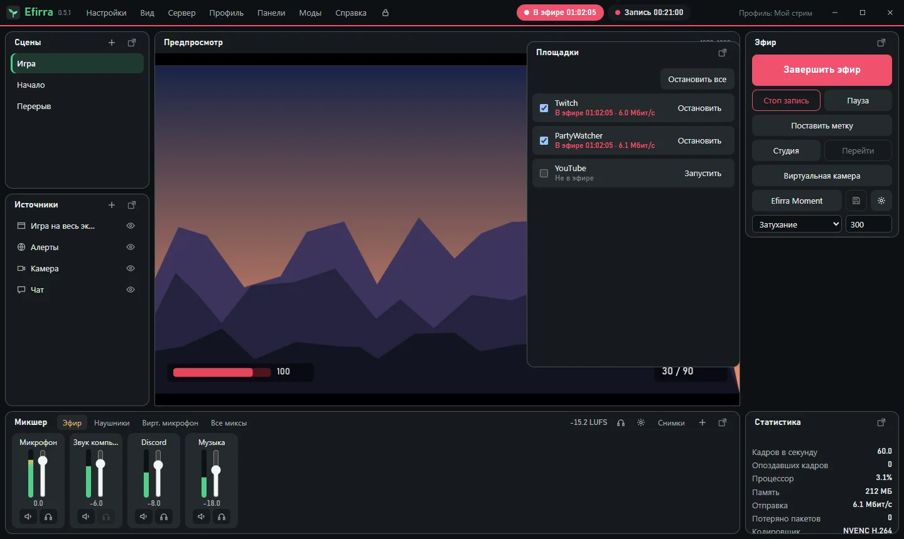
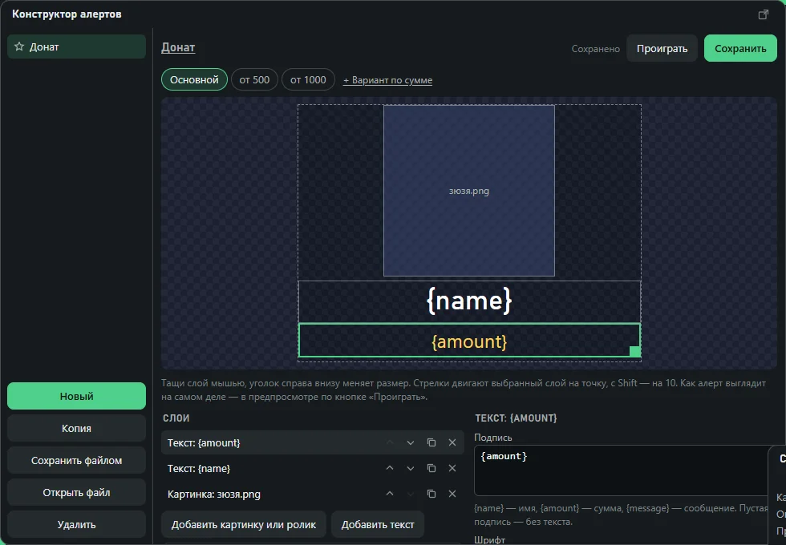
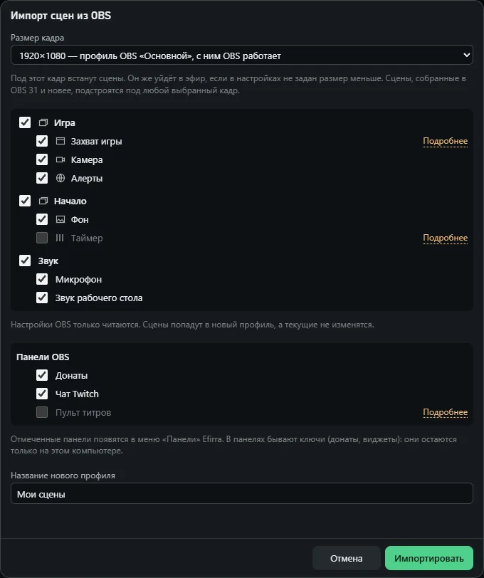
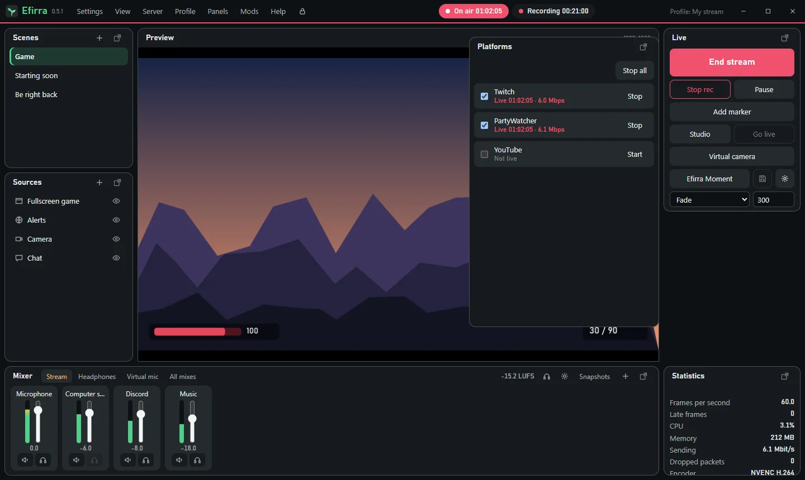
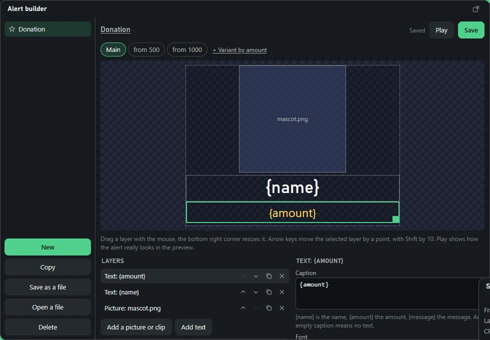
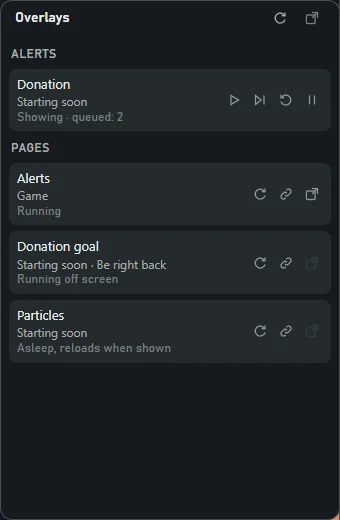
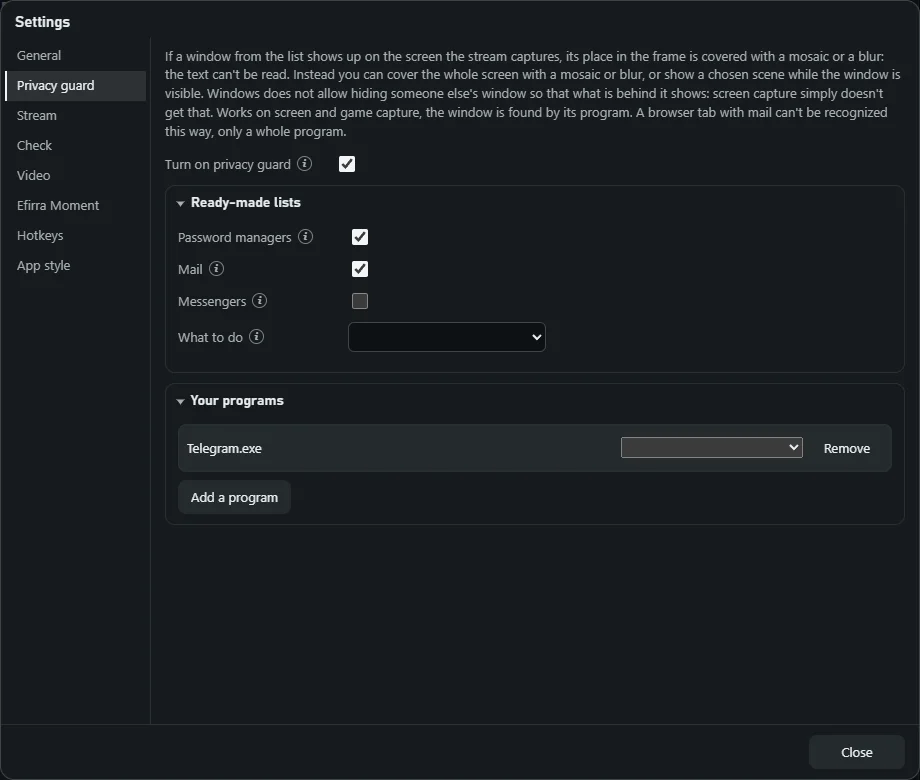

# Efirra

Программа для эфиров и записи на Windows: всё, что умеет OBS, плюс общий чат площадок, свои алерты и моды — и при этом легче. [English below](#english)

**[Скачать установщик](https://github.com/Baamich/Efirra-releases/releases/latest/download/EfirraSetup.exe)** · [Все версии](https://github.com/Baamich/Efirra-releases/releases) · [Моды](https://github.com/Baamich/Efirra-mods)

## Зачем ещё одна программа для эфиров

- **Легче.** Кадр от захвата до кодировщика не покидает видеокарту, а страницы в неактивных сценах засыпают. Основной процесс в замерах в 2 раза легче OBS по процессору и в 2,4 раза по памяти; страницы-виджеты — на уровне OBS.
- **Всё нужное уже внутри.** Несколько площадок сразу, общий чат, алерты, защита личного в кадре, виртуальный микрофон с фильтрами — без плагинов и отдельных программ.
- **Переезд из OBS за пару минут.** Импорт сцен, источников, фильтров, переходов, браузерных панелей и настроек. Окно импорта заранее показывает, что не перенесётся и почему.
- **Пульты как у OBS.** Stream Deck, Streamer.bot, Touch Portal и свои программы подключаются по протоколу obs-websocket 5, как к OBS.

## Что умеет

**Эфир и запись**
- Twitch, YouTube, Kick, VK Видео Live, PartyWatcher и свой сервер — одновременно; каждую площадку можно запустить и остановить отдельно.
- Вход через площадку вместо копирования ключа. Ключи хранятся в защищённом хранилище Windows.
- Свои кодировщики NVENC, AMF и Windows, без FFmpeg. Автобитрейт при плохой сети, задержка эфира, переподключение после обрыва и после сбоя видеокарты.
- Запись в MKV или MP4, HEVC, частями, отдельные дорожки каналов, метки. **Efirra Moment** — последние минуты экрана по одной клавише.
- Проверка перед эфиром: ключи, сеть, микрофон, звук и диск за полминуты.

**Сцены и источники**
- Экран, окно, игра без внедрения в процесс, камера, картинки и GIF, слайд-шоу, видео и списки видео, страницы, текст, чат в кадре.
- Группы, сцена в сцене, режим студии, мультивью, переходы, в том числе роликом с прозрачностью.
- Эффекты: хромакей, маски, скругление и рамка, таблицы цвета, задержка картинки.

**Алерты и оверлеи**
- Свой алерт без браузера: картинки, ролики, звуки и подписи слоями, появление и уход, варианты по сумме, сохранение в файл.
- Запуск клавишей, по таймеру, по событиям Twitch (подписка, подарок, рейд, биты), из Streamer.bot и скриптов.
- Панель **Оверлеи**: все страницы и алерты всех сцен в одном месте — обновить застрявший виджет, не переключая сцену.

**Чат**
- Общий чат Twitch, YouTube, VK Видео Live и PartyWatcher в одной панели и в кадре, со смайлами.
- Команды в чате без Streamer.bot: скрипт отвечает на `!тг` ссылкой прямо в чат VK или Twitch.

**Звук**
- Микшер со своей громкостью на каждой сцене, шумодав, компрессор, эквалайзер, приглушение музыки голосом, плагины VST3.
- Отдельные миксы для эфира, наушников и виртуального микрофона. **Efirra Mic** держит голос с фильтрами в Discord, даже когда окно Efirra закрыто.
- Звуковая панель: звуки в эфир по кнопке и клавише.

**Защита и удобство**
- Защита личного: окно почты, мессенджера или менеджера паролей в кадре закрывается мозаикой или размытием.
- Горячие клавиши, работающие из игры, панели поверх игры, профили, стиль оформления.
- Документация прямо в программе (F1) на русском и английском, с картинками.

**Автоматизация и моды**
- Скрипты на Lua в песочнице: без файлов, сети и ключа эфира, только с разрешения человека.
- [Каталог модов](https://github.com/Baamich/Efirra-mods): скрипты, языки, темы, алерты и панели от других людей. Опасный мод владелец может отозвать, и программа удалит его сама.

## Установка

1. Скачайте и запустите `EfirraSetup.exe`. Права администратора не нужны.
2. Выберите папку и версию, по умолчанию стоит последняя.
3. Дальше обновления приходят сами: программа предлагает их при запуске и проверяет подпись каждого.

Установщик пока без подписи разработчика, поэтому Windows может показать предупреждение SmartScreen. Чтобы продолжить, нажмите «Подробнее» и «Выполнить в любом случае».

**Требования:** Windows 10 или 11, 64 бита. Видеокарта NVIDIA, AMD или Intel для кодирования (без неё — на процессоре). Microsoft Edge WebView2 установщик поставит сам, если его нет.

## Что сейчас происходит

Efirra развивается быстро: новая версия выходит раз в несколько дней, список изменений — в «Справка → Что нового» и в [выпусках](https://github.com/Baamich/Efirra-releases/releases). Сейчас в работе:

- название и категория эфира прямо из программы для всех площадок;
- награды за баллы канала Twitch для алертов;
- чат Kick в общей ленте;
- больше проверки на видеокартах AMD и Intel.

Это ранняя версия. Основная проверка идёт на Windows 10 с видеокартой NVIDIA. Если что-то не работает, приложите файл из «Справка → Открыть папку с логами» к [issue](https://github.com/Baamich/Efirra-releases/issues).

## Приватность

Телеметрии нет. Ключи эфира и входы на площадки хранятся только на вашем компьютере, в хранилище Windows, и идут напрямую на площадки. Логи никуда не отправляются сами.

## Лицензии

Efirra — закрытая программа, здесь только готовые сборки. FFmpeg в программе нет с версии 0.4.0; выпуски 0.3.1 и раньше раздавались с ним под LGPL, его исходники лежат в тех выпусках (`ffmpeg-source-*.zip`). Сторонние компоненты и их лицензии перечислены в `THIRD_PARTY.txt` рядом с программой, исходный файл под MPL-2.0 — в папке `mpl-sources` архива. Efirra не связан с OBS Project, Twitch, YouTube, Kick, VK, Discord, Elgato, VB-Audio и другими упомянутыми компаниями.

---

## English

A streaming and recording app for Windows: everything OBS does, plus a shared chat for all platforms, built-in alerts and mods — and lighter.

**[Download the installer](https://github.com/Baamich/Efirra-releases/releases/latest/download/EfirraSetup.exe)** · [All versions](https://github.com/Baamich/Efirra-releases/releases) · [Mods](https://github.com/Baamich/Efirra-mods)

### Why another streaming app

- **Lighter.** The frame stays on the GPU from capture to encoder, and pages in inactive scenes go to sleep. In measurements the main process uses 2× less CPU and 2.4× less memory than OBS; web widgets are on par with OBS.
- **Everything you need is built in.** Several platforms at once, a shared chat, alerts, privacy protection in the frame, a virtual microphone with filters — no plugins or extra apps.
- **Move from OBS in a couple of minutes.** Scenes, sources, filters, transitions, browser docks and settings are imported. The import window shows in advance what will not carry over and why.
- **Remotes like OBS.** Stream Deck, Streamer.bot, Touch Portal and your own programs connect over obs-websocket 5, just as to OBS.

### Features

**Streaming and recording**
- Twitch, YouTube, Kick, VK Video Live, PartyWatcher and your own server at the same time; each platform starts and stops on its own.
- Sign in with the platform instead of copying the key. Keys are kept in the protected Windows store.
- Its own NVENC, AMF and Windows encoders, no FFmpeg. Automatic bitrate on a bad network, stream delay, reconnecting after a drop and after a GPU reset.
- Recording to MKV or MP4, HEVC, split files, separate channel tracks, markers. **Efirra Moment** saves the last minutes of the screen with one key.
- A pre-stream check: keys, network, microphone, sound and disk in half a minute.

**Scenes and sources**
- Screen, window, game without injection, camera, images and GIFs, slideshows, videos and playlists, pages, text, chat in the frame.
- Groups, scene in a scene, studio mode, multiview, transitions including a stinger with transparency.
- Effects: chroma key, masks, rounded corners and borders, color tables, picture delay.

**Alerts and overlays**
- A built-in alert without a browser: pictures, clips, sounds and captions as layers, entrance and exit, variants by amount, saving to a file.
- Triggered by a hotkey, a timer, Twitch events (sub, gift, raid, bits), Streamer.bot and scripts.
- The **Overlays** panel: every page and alert of every scene in one place — refresh a stuck widget without switching scenes.

**Chat**
- A shared chat of Twitch, YouTube, VK Video Live and PartyWatcher in one panel and in the frame, with emotes.
- Chat commands without Streamer.bot: a script answers `!tg` with a link right in the VK or Twitch chat.

**Sound**
- A mixer with its own volume on every scene, noise suppression, compressor, equalizer, music ducking under your voice, VST3 plugins.
- Separate mixes for the stream, headphones and the virtual microphone. **Efirra Mic** keeps your filtered voice in Discord even when the Efirra window is closed.
- A soundboard: sounds on stream by a button or a hotkey.

**Protection and comfort**
- Privacy protection: a mail, messenger or password manager window in the frame is covered with a mosaic or blur.
- Hotkeys that work from games, panels on top of the game, profiles, app styles.
- Documentation inside the app (F1) in English and Russian, with pictures.

**Automation and mods**
- Lua scripts in a sandbox: no files, network or stream key, and only with the person's permission.
- [Mod catalog](https://github.com/Baamich/Efirra-mods): scripts, languages, themes, alerts and panels by other people. The owner can revoke a dangerous mod, and the app removes it by itself.

### Install

1. Run `EfirraSetup.exe`. No administrator rights are needed.
2. Choose a folder and a version. The latest one is selected by default.
3. Updates are offered at launch, and each one has its signature checked.

The installer has no developer signature yet, so Windows may show a SmartScreen warning. To continue, choose "More info" and "Run anyway".

**Requirements:** 64-bit Windows 10 or 11. An NVIDIA, AMD or Intel graphics card for encoding (without one, the CPU encodes). The installer adds Microsoft Edge WebView2 if it is missing.

### What is happening now

Efirra moves fast: a new version comes out every few days, and the changes are in Help → What's new and in the [releases](https://github.com/Baamich/Efirra-releases/releases). In progress now:

- stream title and category right from the app for every platform;
- Twitch channel point rewards for alerts;
- the Kick chat in the shared feed;
- more testing on AMD and Intel graphics cards.

This is an early version, tested mainly on Windows 10 with an NVIDIA graphics card. If something does not work, attach the file from Help → Open the logs folder to an [issue](https://github.com/Baamich/Efirra-releases/issues).

### Privacy

There is no telemetry. Stream keys and platform sign-ins stay on your computer, in the Windows store, and go straight to the platforms. Logs are never sent anywhere by themselves.

### Licenses

Efirra is closed-source; this repository holds builds only. FFmpeg has not been part of the app since version 0.4.0; releases 0.3.1 and earlier shipped it under the LGPL, and its source is attached to those releases (`ffmpeg-source-*.zip`). Third-party components and their licenses are listed in `THIRD_PARTY.txt` next to the program, and the source file under MPL-2.0 is in the `mpl-sources` folder of the archive. Efirra is not affiliated with the OBS Project, Twitch, YouTube, Kick, VK, Discord, Elgato, VB-Audio or other companies mentioned here.
